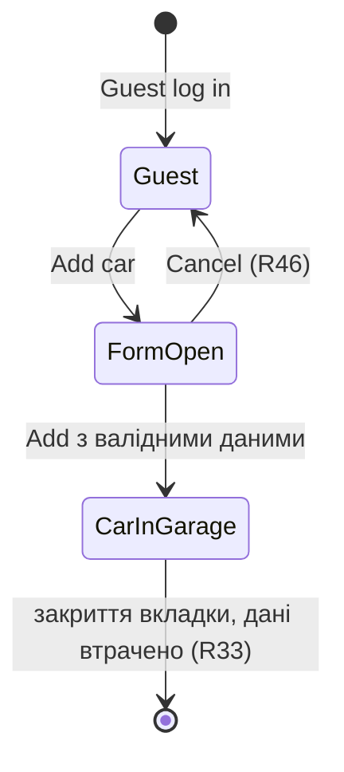

# Крок 2. Аналіз нормалізованих вимог

Застосовано: `normalized-requirement-analysis` (ISO/IEC/IEEE 29148) і `qa-task-analyzer`.
Вхід: лише таблиця з `docs/01-normalized-requirements.md`.

## 1. Підтверджені факти

- Вхід через `Guest log in` є підготовкою (R1, R10), а URL після входу містить `/panel/garage` (R9).
- Тестові дані: `Audi`, `TT`, `12000` (R3–R5).
- Головна перевірка: `Audi TT` видно у Garage після збереження (R7, R11).
- Обсяг: один UI-тест у Chromium зі стартом через `baseURL` (R12, R13).
- У тесті немає registration, API, credentials і Fuel Expenses (R14); fixed waits заборонені (R22).
- Результат запуску підтверджується лише фактичним output (R18).
- Кожен тест сам готує свій стан (R32).
- Дані гостя живуть лише в сесії браузера (R33); гість може додати до 5 авто (R36).
- Brand, Model і Mileage обов'язкові (R38–R40); Mileage — ціле від 0 до 999999 (R41, R42).
- `Add` заблокована при неправильних даних (R44); `Audi` → `TT` є у списку (R51).

## 2. Результати перевірки за чек-листом ISO/IEC/IEEE 29148

### Неоднозначності

| ID | Тип | Проблема |
|---|---|---|
| R7 | лексична | «бачить» не визначає місце й вигляд запису |
| R7 | кількісна | не сказано, чи очікується рівно один запис |
| R8 | референтна | значення URL Garage задане лише в R9 |
| R15 | референтна | файл не існує; правила взято із SPEC-E, збіг не підтверджено |
| R47 | лексична | приклад `BMW/Fiat Palo` не пояснює роль `/`, а SPEC-A очікує `Audi TT` |
| R17 | і/або | незрозуміло, чи допускається `ASSUMPTION` без `STOP` |
| R26 | лексична | перелік «службових файлів» не задано |

### Відсутні негативні випадки

| ID | Що не описано |
|---|---|
| R38, R39 | текст помилки без вибору Brand або Model |
| R40, R42 | текст помилки для порожнього й дробового Mileage |
| R36 | що бачить гість при спробі додати шосте авто |
| R6 | поведінка при помилці збереження |
| R1 | поведінка, якщо гостьовий вхід недоступний |

## 3. Суперечності

**Всередині одного джерела:**

- **R52 проти R53 (SPEC-E):** для `Edit a car` межа `9999999` в описі й `999999` у тексті помилки. На форму `Add a car` не впливає.

**UI проти SPEC:**

- **R48 (SPEC-E) проти R56 (UI):** формат дати `d/m/year` у вимогах і `dd.mm.yyyy` в інтерфейсі.

**Між джерелами:**

- **R24 (SPEC-C) проти R29 (SPEC-D):** ДЗ вимагає публікації у Git, `AGENTS.md` забороняє агенту push.
- **R28 (SPEC-C) проти обраного процесу:** ДЗ називає Codex, а цей процес використовує агенти Playwright у Claude Code.

Конфлікти не зводяться до одного рішення на рівні вимог; рішення людини зафіксовано в run evidence.

## 4. Припущення та QA-ризики

**Припущення:** немає прийнятих мовчки. Значення Audi, TT і 12000 вважаються валідними лише тому,
що SPEC-A називає їх перевіреною навчальною умовою.

| Ризик | Вплив |
|---|---|
| Правила взято з Confluence, а не з названого файлу (R15) | Джерела можуть розходитися |
| Ліміт 5 авто на гостя (R36) | Повторне додавання в одній сесії впреться в ліміт; нова сесія кожного тесту це знімає |
| Ознаки UI можуть змінитися (R16) | Падіння локатора без дефекту продукту |
| Гостьові дані живуть у сесії (R31) | Запис не можна вважати збереженим поза сесією |
| Спільний стенд | Недоступність стенда дасть blocker, а не дефект |
| Застарілий стан між тестами | Хибний результат, якщо тест не готує стан сам (R32) |

## 5. Питання до власника продукту

1. Чи є Confluence остаточним джерелом, якщо `cases/qauto/requirements/add-car.md` відсутній?
2. Яка правильна межа Mileage у формі `Edit a car`: `999999` чи `9999999` (R52, R53)?
3. Що бачить гість при спробі додати шосте авто (R36)?
4. Як виглядає помилка при порожніх полях і при збої збереження?
5. Що вважається «службовими файлами» для здачі?
6. Чи можна використовувати Claude Code замість Codex для перевірки локаторів?
7. Хто дозволяє push: людина чи агент за її дорученням?

## 6. Критерії приймання

**Given/When/Then (AC-1, R1–R7, R9):**

- **Given** користувач увійшов через `Guest log in`
- **When** він обирає `Audi` → `TT`, вводить Mileage `12000` і зберігає форму `Add car`
- **Then** URL містить `/panel/garage`, а запис `Audi TT` видимий у Garage

**NFR (EARS):** числових вимог до продуктивності, безпеки чи доступності в таблиці немає, тому
критерії з вигаданими значеннями не складаються. Єдине перевірюване обмеження безпеки:

- `IF` результати роботи публікуються у Git, `THEN THE` репозиторій `SHALL` не містити credentials (R25).

## 7. Матриця покриття вимог

| ID Вимоги | Твердження | Статус | Тестова ідея / Причина |
|---|---|---|---|
| R1, R2 | Вхід і відкриття форми | Покрито | Кроки TC-001 |
| R3–R6 | Audi, TT, 12000, збереження | Покрито | Кроки TC-001 |
| R7, R11 | `Audi TT` у Garage | Покрито | Перевірка TC-001 |
| R8, R9 | URL Garage | Покрито | Перевірка TC-001 |
| R12, R13, R19, R22, R32 | Обсяг і межі тесту | Покрито | Контролюється кодом тесту |
| R10, R14, R16–R18, R20, R21, R23 | Межі процесу | Покрито | Контроль у run evidence |
| R25–R27 | Вимоги до публікації | Покрито | Перевірка перед push |
| R15 | Посилання на файл правил | Заблоковано | Файл відсутній, правила взято із SPEC-E |
| R33, R35, R37, R45, R47, R51 | Сесія, pop-up, поява й назва авто | Покрито | TC-001 або його передумови |
| R34, R36, R38–R44, R46, R48–R50 | Правила полів, ліміт, Cancel, картка авто | Не покрито | Поза обсягом одного тесту (R12, R14); тестові ідеї нижче |
| R52, R53 | Межа Mileage в Edit a car | Заблоковано | Суперечність у джерелі |
| R54–R56 | Спостереження UI | Не покрито | Поведінка «як є», а не контракт |
| R24, R28, R29 | Конфліктні вимоги | Заблоковано | Потрібне рішення людини |
| R30, R31 | Секрети й життя гостьових даних | Не покрито | Поза обсягом одного тесту |

## 8. Самоперевірка

- Не стверджую текстів помилок для порожніх полів: у джерелах їх немає.
- Не стверджую ознак UI: нормалізація виконана без огляду інтерфейсу.
- Не обираю переможця в конфліктах R24/R29 і R28.
- Не додаю NFR із числами, бо таких значень немає.

---

## Тест-аналіз за техніками (`qa-task-analyzer`)

Значення нижче — лише тестові ідеї. **Автоматизується тільки TC-001** (R12, R14).

**Еквівалентні класи**

| Поле | Валідний клас | Невалідний клас |
|---|---|---|
| Brand | значення зі списку (`Audi`) | не вибрано (чи можливо в UI — невідомо) |
| Model | модель, сумісна з Brand (`TT`) | не вибрано (чи можливо в UI — невідомо) |
| Mileage | ціле від 0 до 999999 (`12000`) | порожнє, дробове, менше 0, більше 999999 |

**Граничні значення Mileage (R41):** `-1` ✗, `0` ✓, `1` ✓, `999998` ✓, `999999` ✓, `1000000` ✗.

**Граничні значення кількості авто гостя (R36):** 4 → 5 дозволено; спроба шостого авто — результат невідомий.

**Таблиця рішень**

| Умова | Д1 | Д2 | Д3 | Д4 |
|---|---|---|---|---|
| Brand і Model обрано | так | так | ні | ні |
| Mileage валідний | так | ні | так | ні |
| Результат | авто у Garage (R45) | `Add` заблокована (R44) | `Add` заблокована (R44) | `Add` заблокована (R44) |

**Переходи станів**

**Pairwise:** не застосовується, бо для автоматизації є одна комбінація параметрів.

**Error Guessing (ідеї для майбутнього, поза обсягом ДЗ):** подвійне натискання збереження,
дублікат авто, зміна Brand після вибору Model, Mileage з пробілами, втрата сесії перед збереженням.
